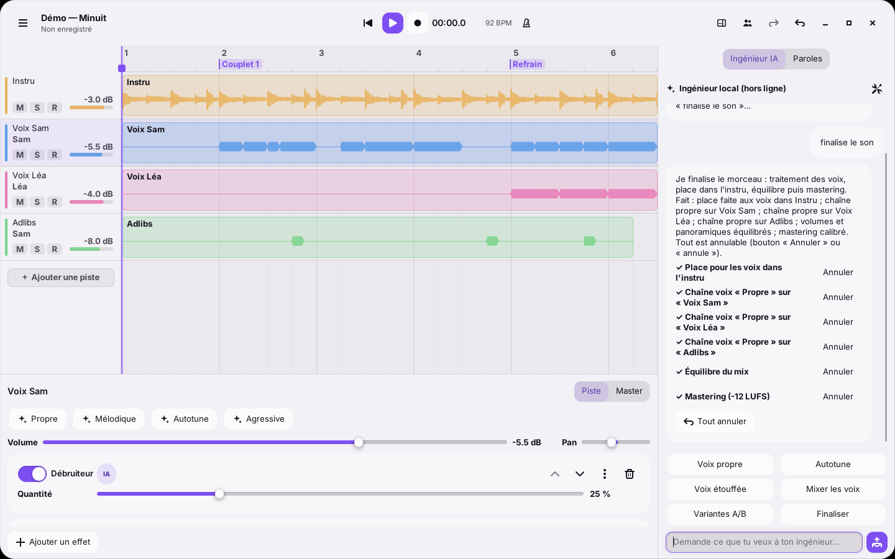

<!-- SPDX-License-Identifier: GPL-3.0-or-later -->

# Awra Studio

Un studio musical natif, simple à prendre en main, libre d'aller loin, avec
un **ingénieur du son IA qui agit** et des **sessions à plusieurs sans
serveur**. Construit en Rust sur le framework [Awra](../README.md).



## Ce qu'on peut faire

- **Poser une instru, enregistrer, finir le son.** Glisse une instru dans
  la fenêtre (son tempo et sa tonalité sont détectés), arme une piste,
  appuie sur `R`, chante. « Finaliser le morceau » traite les voix, fait de
  la place dans l'instru, équilibre et masterise : un vrai rendu, pas une
  maquette. Export WAV 16/24/32 bits avec mesure LUFS / true peak.
- **Parler à l'ingénieur IA** : « rends ma voix plus propre », « mets un
  autotune bien calibré », « ma voix est étouffée », « fais ressortir les
  adlibs », « mixe nos deux voix », « fais un mastering propre », « essaie
  un rendu plus mélodique », « propose plusieurs variantes »… Il écoute
  (analyse), décide, règle les effets lui-même ; chaque action a son bouton
  **Annuler**. Après une prise, il propose spontanément des améliorations.
- **Références** : importe un morceau dont tu aimes le son, l'IA en
  reprend l'autotune, la réverbe, l'ambiance, l'équilibre et le niveau.
- **Interface à ta main** : panneaux déplaçables, redimensionnables,
  masquables (mode édition `Ctrl+E`), espaces prêts (Enregistrement,
  Écriture, Mixage, Minimal, À plusieurs)… et l'IA réorganise l'interface
  sur demande (« mets les paroles à droite et agrandis la timeline »,
  « ajoute les réglages d'autotune sous ma piste », « simplifie mon
  interface »).
- **À plusieurs, chacun chez soi** : l'un héberge, les autres collent le
  code d'invitation. Pistes, prises (les fichiers voyagent), paroles,
  réglages, lecture synchronisée et discussion. Chiffré, pair à pair,
  aucun serveur : les projets restent sur vos machines.
- **Paroles** : un carnet de couplets / refrains partagé et lié à la
  timeline.
- **Effets intégrés** : égaliseur, compresseur, noise gate, de-esser,
  débruiteur spectral, réverbe, delay synchronisé, saturation,
  **autotune temps réel** (tonalité, gamme, vitesse, humanisation),
  limiteur, doubleur, largeur stéréo. **Plugins VST3 et CLAP** en plus.

## Les modèles d'IA

L'**ingénieur local** fonctionne sans aucune connexion. Pour des demandes
libres, connecte ce que tu as déjà (Projet ▸ Réglages de l'assistant) :

| Choix | Ce qu'il faut |
| --- | --- |
| ChatGPT (abonnement) | l'outil officiel **Codex CLI** : `codex login` = « Sign in with ChatGPT » ; Awra Studio le pilote (`codex exec`) |
| Claude (abonnement) | **Claude Code** connecté (`claude`) ; Awra Studio le pilote (`claude -p`) |
| Claude (clé API) | une clé Anthropic ; modèle par défaut `claude-opus-5-5` |
| OpenAI (clé API) | une clé OpenAI |
| Modèle local | Ollama, LM Studio, llama.cpp… (API compatible OpenAI, `http://localhost:11434/v1` par défaut) |

Le modèle agit par les mêmes outils que l'interface (22 outils : analyse,
chaînes de voix, mix, mastering, références, variantes, interface…). Si le
modèle échoue, l'ingénieur local prend le relais.

## Installer depuis les sources

### Fedora (Wayland ou X11)

```sh
sudo dnf install gcc gcc-c++ cmake ninja-build pkgconf-pkg-config \
    wayland-devel libxkbcommon-devel alsa-lib-devel rust cargo
cd studio
cargo build --release -p awra-studio
./target/release/awra-studio            # ou --demo pour le morceau de démonstration
./packaging/install-linux.sh            # raccourci dans le menu des applications
```

L'audio passe par ALSA, donc par PipeWire sur Fedora (paquet
`pipewire-alsa`, installé par défaut).

### Windows

Avec Rust (MSVC) et CMake installés :

```powershell
cd studio
cargo build --release -p awra-studio
.\target\release\awra-studio.exe
```

Ou depuis Linux, en croisé avec MinGW-w64 (`.cargo/config.toml` est prêt) :

```sh
rustup target add x86_64-pc-windows-gnu
cargo build --release --target x86_64-pc-windows-gnu -p awra-studio
```

L'exécutable ne dépend que de DLL du système.

## Raccourcis

| Touche | Action |
| --- | --- |
| `Espace` | lecture / pause |
| `R` | enregistrer sur la piste sélectionnée (en crée une au besoin) |
| `Début` | revenir au début |
| `Ctrl+Z` / `Ctrl+Maj+Z` | annuler / rétablir |
| `S` / double-clic sur un clip | couper le clip |
| `Suppr` | supprimer le clip sélectionné |
| `Ctrl+molette` | zoom ; `Maj+molette` : défiler dans le temps |
| `Maj+glisser` sur la règle | boucle (double-clic sur la règle : la retirer) |
| double-clic / clic droit sur une piste | renommer, type, couleur, supprimer |
| `Ctrl+E` | personnaliser l'interface |
| `Ctrl+S` | enregistrer le projet |

## Le projet sur disque

Un projet est un dossier `Nom.awra/` : `project.json` (pistes, clips,
effets, paroles, références, variantes) et `assets/` (les fichiers audio,
nommés par leur empreinte BLAKE3 : une prise partagée en session n'est
stockée qu'une fois). Enregistrement automatique toutes les deux minutes
une fois le projet enregistré.

## Documentation

- [docs/ARCHITECTURE.md](docs/ARCHITECTURE.md) : comment c'est construit.
- [docs/JOURNAL.md](docs/JOURNAL.md) : le journal de développement
  (décisions, état, pièges).

## Licence

GPL-3.0-or-later, comme Awra 2.
